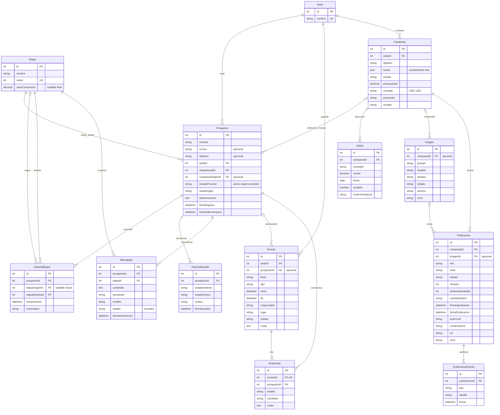

# Modelo de datos

Las entidades de negocio, salvo los historiales inmutables, incluyen createdAt y updatedAt. Los historiales usan su fecha de evento. Claves foráneas RESTRICT en eliminación y CASCADE en actualización. No se elimina información histórica desde la API.

Índices: orden único de etapas; sede/canal/ingreso; etapa actual/último avance; estado/sede; historial único persona/etapa destino; sede/responsable/horario; persona/estado de entrevista; campaña/fecha/anulación de gasto; estado/creación de publicaciones.

Campania.textos es JSON de tres textos sin ciclo de vida independiente. Publicacion sí tiene entidad propia porque requiere revisión, aprobación, envío y auditoría por cada pieza.

El bloqueo de fila de Prospecto protege avances y estados. La fila Sede serializa reservas para detectar superposiciones; Campania serializa cambios de presupuesto y gastos; Publicacion serializa aprobaciones, revisiones e intentos de envío. La transacción de publicación se libera antes de llamar a Meta, manteniendo el estado publicando para bloquear otro envío.
